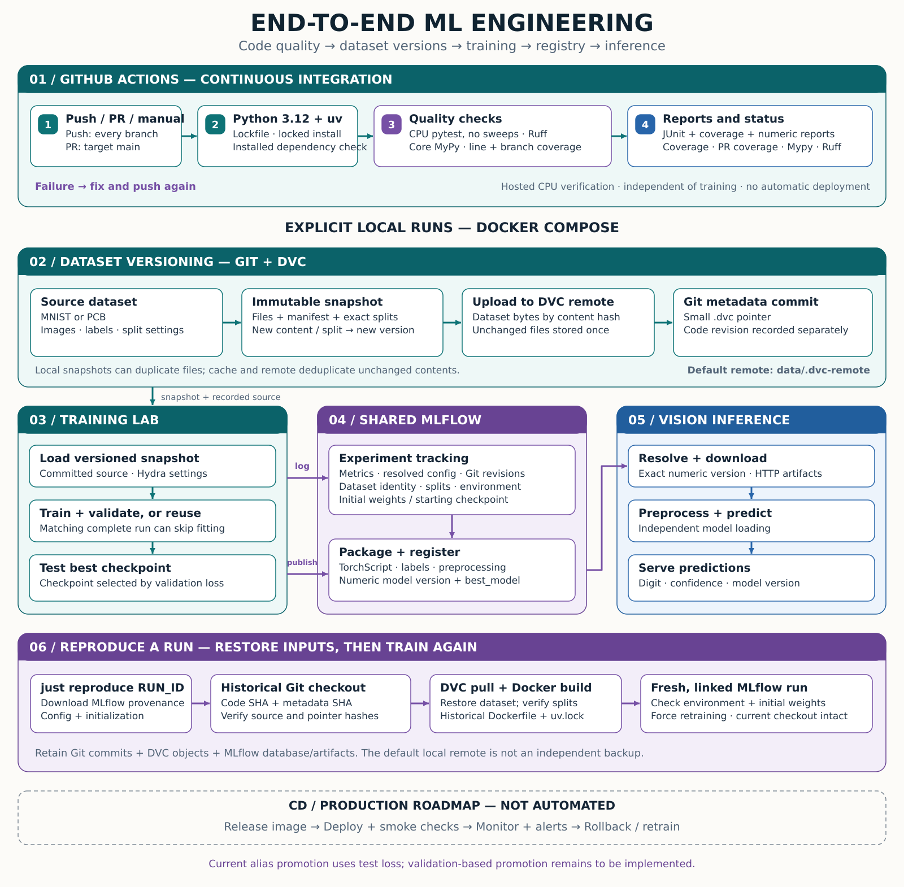

# ML Engineering Lab

## Project overview

Train and evaluate image classifiers with PyTorch, Lightning, and Hydra. The
current example is a custom ResNet for MNIST, with configurable training,
checkpoint resume, metrics, and MLflow tracking. PCB classification is also
supported. Git records code and dataset pointers, DVC stores dataset versions,
and MLflow records experiments and model artifacts.

This project publishes packaged models to a shared MLflow registry.
[Vision inference](https://github.com/ohadjerci/vision-inference) downloads those
models and predicts digits independently on CPU.

## Prerequisites

- Linux x86-64, Git, Docker Engine, and Docker Compose 2.30 or later.
- An NVIDIA GPU, compatible driver, and NVIDIA Container Toolkit for the
  **training and test Compose services**, even when selecting a CPU trainer.
- Internet access for images, locked dependencies, and the first MNIST download;
  allow substantial disk space for the CUDA image.

MLflow itself and the separate inference application can run without a GPU.
Python 3.12, uv, PyTorch, and CUDA dependencies are installed in containers;
no host Python environment is needed. See [configuration](docs/configuration.md)
for CPU options and the current Compose limitation.

## Quick start

Run commands in the **training repository root** after cloning.

1. **Get the project.**

   ```bash
   git clone https://github.com/ohadjerci/ml-engineering-lab.git
   cd ml-engineering-lab
   ```

2. **Initialize storage, build the image, and start MLflow.**

   ```bash
   bash scripts/setup.sh
   ```

   Run as your normal host user. Setup saves your UID/GID in the ignored `.env`,
   preserves other settings, and waits for [MLflow](http://localhost:50001) to be healthy.
   See [setup explained](docs/setup.md) for every command, prerequisites, and recovery.

3. **Train.**

   ```bash
   just train
   # Without just:
   docker compose run --build --rm train
   ```

   Configure Git identity if setup reports it missing. The first default run can
   train for up to 500 epochs; use the bounded example below for a quick first run.

## Training example and results

From the **training repository root**, run one epoch on the default GPU trainer:

```bash
docker compose run --rm train uv run --locked python src/train.py \
  trainer.max_epochs=1 data.num_workers=0
```

This downloads MNIST, trains, tests the best validation checkpoint, and registers
a packaged `MNIST` model. A short run demonstrates the workflow; its accuracy is
not a quality guarantee. Omitting the epoch override uses a maximum of 500 epochs.

Before versioned training, commit relevant source/configuration and configure Git
`user.name` and `user.email`. Preparation uploads an immutable dataset snapshot to
DVC and commits only its metadata. Matching completed experiments can be reused.
Use `just train` for subsequent runs; it rebuilds the Docker image.

```bash
# Independent dataset preparation, without requesting a GPU.
just prepare-data
just prepare-data-pcb
# Train even if a matching completed run exists.
just train reproducibility.force_retrain=true
# Restore code, data and settings into an isolated checkout and train again.
just reproduce ORIGINAL_MLFLOW_RUN_ID
```

These recipes use Docker Compose. See [versioning, storage, and reproduction](docs/versioning-and-reproduction.md)
for how code, data, settings, and initial weights are recovered.

- Checkpoints: `logs/train/runs/<timestamp>/checkpoints/`, including `last.ckpt`.
- Run configuration, logs, and results: `logs/train/runs/<timestamp>/`.
- Metrics and model versions: the **`MNIST`** experiment and **`MNIST`**
  registered model in [MLflow](http://localhost:50001). The UI stays running.

Inference can select a numeric model version or the `best_model` alias.
**Current mismatch:** checkpoint selection uses validation loss, but alias
promotion uses **test loss**, contrary to the agreed validation-based promotion
requirement. See [model selection](docs/architecture.md#model-selection-mismatch).

### Training with uncommitted changes

Use `just train-dev` for MNIST or `just train-pcb-dev` for PCB while editing code
or configuration. They rebuild with local changes and skip dataset versioning,
automatic metadata commits, and experiment reuse. MLflow logging still applies.

```bash
just train-dev
just train-pcb-dev trainer=cpu trainer.precision=32-true trainer.max_epochs=1
# Equivalent without the shortcut:
just train-pcb versioning.enabled=false
```

Return to `just train` or `just train-pcb` after committing relevant changes.
See the [versioning guide](docs/versioning-and-reproduction.md) for preparation,
reuse, and replay requirements.

## Pipeline

[](docs/assets/ml-engineering-pipeline.svg)

Click the diagram to view it at full size. See [versioning and reproduction](docs/versioning-and-reproduction.md)
for the storage layout and replay steps.

CI verifies changes independently of training; it does not deploy models or run
GPU verification. The PR report shows **Coverage**, **PR coverage**, **Mypy**, and
**Ruff**. See [CI details](docs/development.md) for checks, artifacts, and local commands.

## Further documentation

- [Setup explained and manual commands](docs/setup.md)
- [Versioning, dataset storage, and training reproduction](docs/versioning-and-reproduction.md)
- [VS Code breakpoint debugging in Docker](docs/development.md#vs-code-breakpoints-in-docker)
- [MLflow setup, storage, and shared connectivity](docs/mlflow.md)
- [Environment variables and Hydra configuration](docs/configuration.md)
- [Architecture and model registration](docs/architecture.md)
- [Development, tests, coverage, and CI](docs/development.md)
- [Troubleshooting](docs/troubleshooting.md)
- [Historical file-store migration](docs/migration.md)
- [Vision inference repository](https://github.com/ohadjerci/vision-inference)

## PCB classification and command recipes

MNIST remains the default. See [PCB workflow](docs/pcb.md) for complete-group
binary classification, configurable Hydra presets, and the `justfile` recipes
for training, checkpoint validation/evaluation, tests, Ruff, and MyPy.
